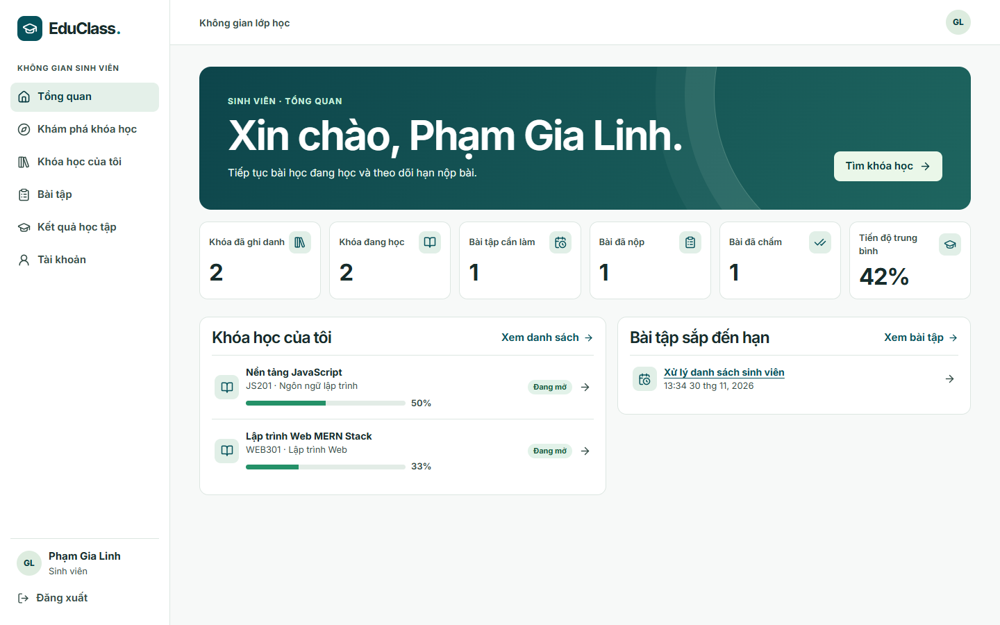

# EduClass · Hệ thống Lớp học Trực tuyến

Tiểu luận cuối kỳ môn **Lập trình Web (MERN Stack)**. EduClass tổ chức danh mục khóa học, bài học, tài liệu, bài tập, lượt ghi danh và điểm số trên cùng một hệ thống.

| Vai trò | Chức năng chính |
| --- | --- |
| Sinh viên | Đăng ký, tìm lớp đang mở, ghi danh, đọc bài học, xem video, tải PDF, nộp bài bằng văn bản hoặc PDF/TXT, xem tiến độ, điểm và nhận xét. |
| Giảng viên | Quản lý khóa học của mình, sắp xếp bài học, đăng học liệu, giao bài, xem sinh viên đã ghi danh và chấm, công bố điểm. |
| Quản trị viên | Duyệt và lọc người dùng, tạo tài khoản giảng viên, khóa/mở tài khoản, quản lý danh mục khóa học toàn hệ thống. |

## Cài đặt và chạy

Clone từ [repository EduClass](https://github.com/NguyenVuMinhTien/educlass-mern) hoặc dùng bản ZIP. Từ thư mục chứa dự án:

~~~bash
git clone https://github.com/NguyenVuMinhTien/educlass-mern.git
cd educlass-mern
~~~

Cần Node.js 22.12+ hoặc 24 LTS, npm, Git và một máy chủ MongoDB Community đang chạy, hoặc cụm MongoDB Atlas. Dùng terminal tại thư mục gốc của dự án sau khi giải nén hoặc clone repository đã nhận.

```powershell
npm ci
Copy-Item server/.env.example server/.env
node -e "console.log(require('node:crypto').randomBytes(48).toString('hex'))"
```

Đặt giá trị ngẫu nhiên vừa sinh vào `JWT_SECRET` trong `server/.env`. Mặc định dùng MongoDB tại `127.0.0.1:27017`, cơ sở dữ liệu `educlass`. Đổi `MONGODB_URI` khi dùng cấu hình khác. Các thao tác tương đương trên macOS/Linux dùng `cp` thay cho `Copy-Item`.

```text
npm run seed
npm run dev
```

Mở **http://localhost:5173/**. API ở **http://127.0.0.1:5000/api/v1** và được Vite proxy qua `/api`. Có thể chạy riêng bằng `npm run dev:server` và `npm run dev:client`. `client/.env.example` trình bày cấu hình tùy chọn.

### Tài khoản demo

| Vai trò | Email | Mật khẩu demo |
| --- | --- | --- |
| Quản trị | admin@educlass.example | `EduClass!2026` |
| Giảng viên | teacher1@educlass.example | `EduClass!2026` |
| Sinh viên | student1@educlass.example | `EduClass!2026` |

Seed dùng khóa nhận dạng cố định cho dữ liệu mẫu và giữ nguyên các bản ghi đã có. Giảng viên demo số 1 có lớp MERN với ba bài nộp và một điểm đã công bố. Môi trường production chỉ khởi tạo quản trị viên khi cung cấp `ADMIN_EMAIL` và `ADMIN_PASSWORD` riêng.

### Kiểm thử và build

```text
npm run lint
npm test
npm run build
```

`npm test` cần MongoDB có quyền tạo và xóa cơ sở dữ liệu kiểm thử. Script tạo tên ngẫu nhiên cho từng lần chạy, dùng `TEST_MONGODB_URI` nếu được đặt. Với dữ liệu seed mới và Chrome cài sẵn, chạy `node scripts/browser-check.mjs` khi ứng dụng đang chạy để kiểm tra luồng trình duyệt và chụp ảnh. Có thể đặt `BROWSER_EXECUTABLE` khi dùng Edge hoặc Chromium.

Build xong, `npm start` phục vụ cả giao diện đã build và API qua Express. Khi chạy thử build cục bộ, đặt `CLIENT_URL=http://localhost:5000` rồi mở địa chỉ đó. Môi trường production cần HTTPS cùng origin, MongoDB riêng và thư mục upload bền vững. Dùng `TRUST_PROXY=1` khi Express đứng sau đúng một reverse proxy tin cậy. [Hướng dẫn vận hành](docs/installation.md)

## Kiến trúc và tài liệu

```text
client/              React, Vite, Context API, Router, Axios, Tailwind, Lucide
server/src/routes/   Đường dẫn REST và middleware theo vai trò
server/src/controllers/   Nghiệp vụ và kiểm tra quyền sở hữu
server/src/models/   Schema và index Mongoose
server/src/seed.js   Nạp dữ liệu demo, khai báo lượt ghi danh và điểm mẫu
server/test/         Kiểm thử tích hợp bằng MongoDB
scripts/             Kiểm thử trình duyệt và tạo báo cáo
docs/                Tài liệu kỹ thuật và ảnh chụp ứng dụng
```

- [Kiến trúc và nghiệp vụ](docs/architecture.md) · [ERD và schema](docs/database.md) · [Tài liệu REST API](docs/api.md)
- [Cài đặt, vận hành và GitHub](docs/installation.md) · [Kết quả kiểm thử](docs/testing.md) · [Đối chiếu yêu cầu](docs/traceability.md)
- [Kịch bản demo và 30 câu hỏi bảo vệ](docs/defense.md) · [Bộ ảnh minh chứng](docs/screenshots/)



## Nộp lên GitHub

Tạo repository trên [GitHub](https://github.com/new), chọn chế độ hiển thị theo yêu cầu của giảng viên, rồi dùng URL repository thực tế. Nếu chọn private, cấp quyền cho tài khoản GitHub của giảng viên. Báo cáo chứa thông tin nhóm được nộp riêng dưới dạng PDF.

```bash
git remote add origin https://github.com/NguyenVuMinhTien/educlass-mern.git
git push -u origin main
```

Chạy `git status --ignored --short` để kiểm tra `.env`, thư mục upload, dữ liệu MongoDB cục bộ, `node_modules` và báo cáo có MSSV đều đã được loại trừ. Nếu khởi tạo từ một bản sao dạng ZIP, thực hiện `git init -b main`, `git add .` và tạo commit trước khi push.
