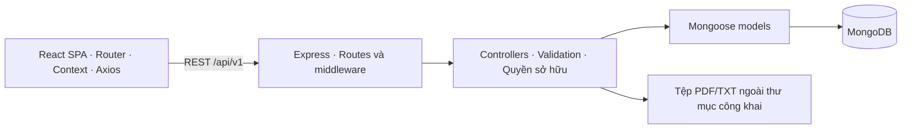

# Kiến trúc EduClass

## Phạm vi và tác nhân

| Vai trò | Phạm vi | Giao diện |
| --- | --- | --- |
| Khách | Giới thiệu, danh mục mở, đăng nhập, đăng ký sinh viên | `/`, `/khoa-hoc`, `/dang-nhap`, `/dang-ky` |
| Sinh viên | Học liệu thuộc lớp đã ghi danh, bài nộp và điểm đã công bố của chính mình | `/app/kham-pha`, `/app/khoa-hoc`, `/app/bai-tap`, `/app/ket-qua` |
| Giảng viên | Khóa học do mình phụ trách, sinh viên và bài nộp trong lớp đó | `/app/khoa-hoc/:id`, `/app/bai-tap/:id` |
| Quản trị viên | Hồ sơ tài khoản, danh mục khóa học, điều chỉnh trạng thái toàn hệ thống | `/app/nguoi-dung`, `/app/danh-muc` |

Frontend giữ phiên trong Context, lấy hồ sơ bằng `GET /auth/me` và gọi API bằng Axios. Route guard phục vụ điều hướng. Backend kiểm chứng cookie và quyền tài nguyên cho từng yêu cầu. Thành phần giao diện render nội dung bài đọc và bài làm dưới dạng văn bản. Mô hình danh mục dùng thuộc tính `Course.category` và bộ lọc, với màn hình quản trị toàn hệ thống.

## Luồng chính

### Đăng ký và phiên đăng nhập

Đăng ký chuẩn hóa email, kiểm tra mật khẩu xác nhận, hash bằng bcrypt và gán vai trò sinh viên. Admin cấp tài khoản giảng viên. Đăng nhập tạo bản ghi phiên MongoDB có TTL và JWT HS256 có định danh người dùng, định danh phiên, issuer và thời hạn. Cookie dùng HttpOnly, SameSite=Lax và Secure khi production. Middleware kiểm tra chữ ký, phiên và trạng thái tài khoản. Đăng xuất xóa phiên và xóa cookie. Các thao tác thay đổi dữ liệu yêu cầu Origin trùng với origin cấu hình.

### Ghi danh và tiến độ

Danh mục công khai chọn khóa đang mở. `POST /courses/:courseId/enroll` kiểm tra trạng thái và tạo Enrollment. Index duy nhất theo sinh viên và khóa học cho phép xử lý ghi danh trùng kể cả khi nhiều yêu cầu đến cùng lúc. Đánh dấu hoàn thành dùng `$addToSet`. Phần trăm là số bài còn hiệu lực đã hoàn thành chia cho số bài còn hiệu lực, làm tròn tới số nguyên. Với lớp có 0 bài học, tiến độ là 0%.

### Nộp bài và chấm điểm

Sinh viên có thể gửi nội dung, tệp PDF/TXT hoặc cả hai khi lớp mở. Lần nộp đầu sau hạn chỉ được nhận nếu giảng viên bật tùy chọn. Cập nhật bài nộp yêu cầu trước hạn và chưa có điểm. Một bài nộp hiện hành cho mỗi sinh viên và bài tập. Điều kiện được đánh giá theo thời gian máy chủ, dữ liệu lưu UTC và hiển thị theo giờ Việt Nam. Giảng viên nhập điểm từ 0 đến điểm tối đa và chọn lưu nháp hoặc công bố. Điểm nháp và nhận xét nháp được ẩn khỏi response của sinh viên.

### Lưu trữ và xóa

Có bốn trạng thái lớp. Khóa lớp cho phép đọc lại học liệu của lượt ghi danh cũ, dừng ghi danh mới và nộp bài. Xóa lớp áp dụng với bản nháp chưa có ghi danh. Xóa bài tập áp dụng khi chưa có bài nộp. Các bản ghi này và bài học bị xóa được đánh dấu thời điểm xóa để giữ tham chiếu, đồng thời bị loại khỏi truy vấn thông thường. Tài liệu còn tồn tại khi bài học đi kèm bị xóa. Điểm tối đa được cố định lúc tạo bài tập để giữ cùng thang điểm cho mọi lượt chấm. Admin có thể lưu trữ lớp trên toàn hệ thống và giáo viên không được tự mở lại lớp đang bị quản trị lưu trữ.

Tệp được ghi dưới khóa ngẫu nhiên sau khi có kiểm tra quyền và định dạng. MongoDB giữ metadata. Tải hoặc xem trước đi qua middleware và kiểm tra quyền. Khi quá trình ghi MongoDB thất bại, hệ thống dọn tệp vừa tạo. Khi sửa thành công, hệ thống dọn tệp cũ. `Session` có cơ chế dọn TTL riêng.

## Giới hạn

Dự án được kiểm tra với một tiến trình Express và MongoDB cục bộ. Tệp nằm trên hệ thống tệp của máy chủ. Để chạy nhiều máy chủ cần kho tệp dùng chung và rate limiter dùng kho trạng thái chung. Bản sao lưu vận hành cần lưu MongoDB và thư mục tệp cùng phạm vi. Không có email xác nhận, khôi phục mật khẩu hoặc lớp học video trực tiếp trong phạm vi triển khai.
