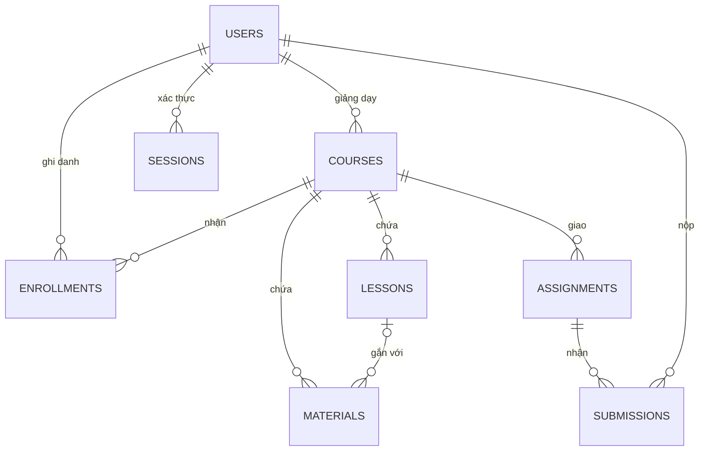

# Thiết kế cơ sở dữ liệu

| Collection | Trường chính và quan hệ | Chỉ mục / ràng buộc |
| --- | --- | --- |
| users | `fullName`, `email`, `passwordHash`, `role`, `isActive` | `email` duy nhất, chỉ mục `role`. Hash bị loại khi truy vấn mặc định. |
| courses | `title`, `courseCode`, `description`, `thumbnail`, `category`, `teacherId`, `status`, `moderated`, `deletedAt` | `courseCode` duy nhất. Chỉ mục trên `category`, `teacherId`, `status`. |
| enrollments | `studentId`, `courseId`, `enrolledAt`, `completedLessonIds` | Duy nhất theo `studentId + courseId`. Chỉ mục `courseId`. |
| lessons | `courseId`, `title`, `content`, `order`, `deletedAt` | Chỉ mục `courseId`. Hiển thị theo `order` rồi thời điểm tạo. |
| materials | `courseId`, `lessonId?`, `uploadedBy`, `title`, `type`, `content?`, `url?`, `file?` | Chỉ mục `courseId`. Loại `pdf`, `video` hoặc `text`. |
| assignments | `courseId`, `teacherId`, `dueDate`, `maxScore`, `allowLateSubmission`, `file?`, `deletedAt` | Chỉ mục `courseId`. Điểm tối đa từ 1 đến 1000. |
| submissions | `assignmentId`, `studentId`, `textContent?`, `file?`, `submittedAt`, `isLate`, `score`, `feedback?`, `gradedBy?`, `gradedAt?`, `published` | Duy nhất theo `assignmentId + studentId`. Chỉ mục `studentId`. Điểm chưa chấm là `null`. |
| sessions | `userId`, `expiresAt` | TTL theo `expiresAt`. Chỉ mục `userId`. |

Mỗi schema có `createdAt` và `updatedAt`. Các trường định danh có dạng ObjectId. Enrollments hiện thực quan hệ nhiều-nhiều giữa sinh viên và khóa học, cùng thông tin riêng của từng lượt ghi danh. Hồ sơ nộp bài có vòng đời riêng nên được tham chiếu thay vì nhúng vào Assignment. Metadata tệp nhúng trong document vì nó thuộc đúng một tài nguyên. Backend có kiểm tra quan hệ cùng khóa học cho lessonId của học liệu. Tên file lưu trữ là khóa UUID, ứng dụng trả tên tệp hiển thị, MIME và dung lượng.
